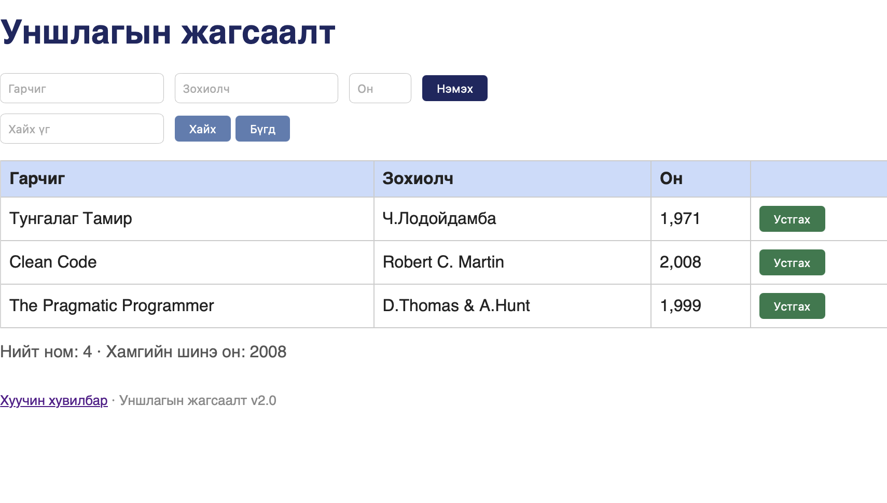

# BUG-01: «Нийт ном» тоолуур хүснэгтэд буй номын тооноос 1-ээр их (3 ном байхад 4 гэж харагдана)

Орчин: Уншлагын жагсаалт v2.0, Safari 26.5.2, macOS 26.5.2, 2026-11-24

Урьдчилсан нөхцөл: node app.js-ийг шинээр асаасан (анхны 3 ном)

## Дахин гаргах алхам

1. Терминалд node app.js-ийг шинээр ажиллуул (анхны 3 ном байна).
2. Браузерт http://localhost:3000 нээ.
3. Хүснэгтэд хэдэн ном байгааг тоол (Тунгалаг Тамир, Clean Code, The Pragmatic Programmer, нийт 3).
4. Хүснэгтийн доорх «Нийт ном: ...» мөрийг хар.

Хүлээгдэж байсан: спецификацийн «Нийт ном тоолуур хүснэгтэд буй номын тоотой тэнцүү» дүрмээр «Нийт ном: 3».

Бодит үр дүн: «Нийт ном: 4 · Хамгийн шинэ он: 2008» гэж харагдана (хүснэгтэд 3 ном).

Ноцтой байдал: Major. Хуудас ачаалах бүрд буруу тоо харуулж, хэрэглэгчид өгөгдлийн талаар худал мэдээлэл өгч байна, гэхдээ үндсэн үйлдлүүд (нэмэх, устгах) ажиллаж байна.

Хавсралт: 

Олдсон аялал: Fed-Ex (өгөгдлийн зам: хүснэгт ба тоолуурын уялдаа)
