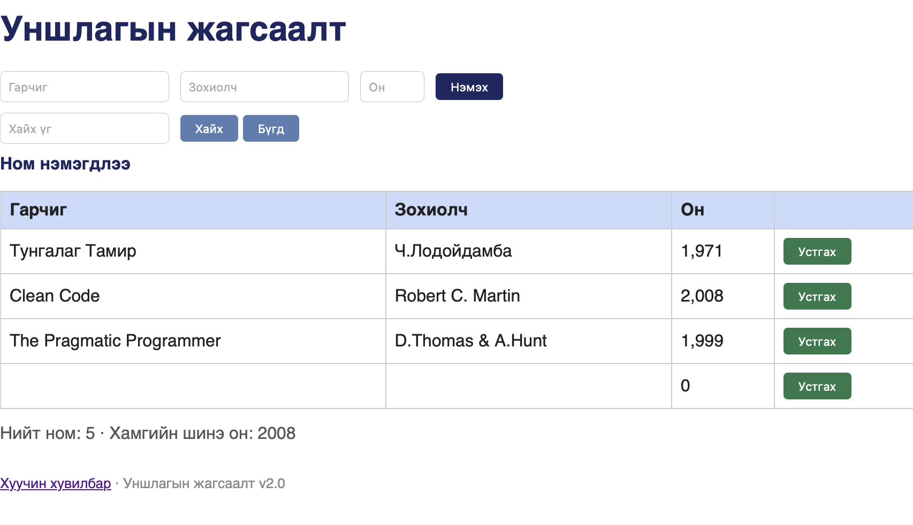

# BUG-03: Бүх талбар хоосон байхад «Нэмэх» дарахад хоосон мөр бүхий ном нэмэгдэж, амжилттай гэж мэдэгдэнэ

Орчин: Уншлагын жагсаалт v2.0, Safari 26.5.2, macOS 26.5.2, 2026-11-24

Урьдчилсан нөхцөл: node app.js-ийг шинээр асаасан (анхны 3 ном)

## Дахин гаргах алхам

1. Терминалд node app.js-ийг шинээр ажиллуул (анхны 3 ном байна).
2. Браузерт http://localhost:3000 нээ.
3. Гарчиг, Зохиолч, Он гурван талбарыг хоосон орхи.
4. «Нэмэх» товчийг дар.

Хүлээгдэж байсан: спецификацийн «Гарчиг, Зохиолч, Он гурван талбар бүгд заавал бөглөгдсөн байх ёстой; дутуу бол ном нэмэгдэхгүй, ойлгомжтой алдааны мессеж харагдана» дүрмээр шинэ ном нэмэгдэхгүй, алдааны мессеж гарна.

Бодит үр дүн: «Ном нэмэгдлээ» гэсэн мессеж гарч, хүснэгтэд Гарчиг ба Зохиолч нь хоосон, Он нь 0 гэсэн шинэ мөр нэмэгдэнэ (хүснэгт 3 мөрөөс 4 мөр болно, «Нийт ном: 5»).

Ноцтой байдал: Major. Заавал бөглөх талбарын шалгалт огт ажиллахгүй тул утгагүй (хоосон) өгөгдөл хадгалагдаж, хэрэглэгчид амжилттай гэж хэлж буй.

Хавсралт: 

Олдсон аялал: Couch Potato (хоосон оролт)
