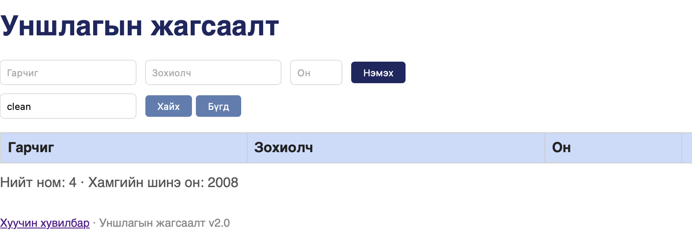
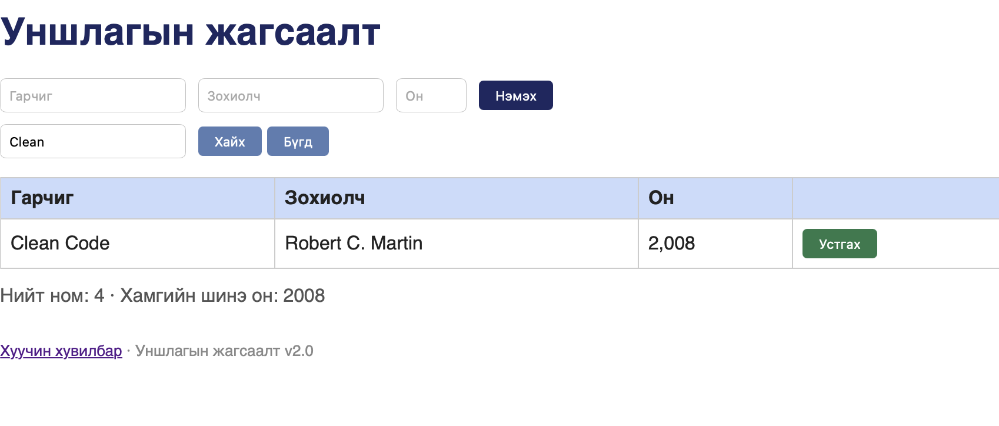

# BUG-04: Хайлт том/жижиг үсгийг ялгадаг: жижиг үсгээр хайхад ном олдохгүй

Орчин: Уншлагын жагсаалт v2.0, Safari 26.5.2, macOS 26.5.2, 2026-11-24

Урьдчилсан нөхцөл: node app.js-ийг шинээр асаасан (анхны 3 ном)

## Дахин гаргах алхам

1. Терминалд node app.js-ийг шинээр ажиллуул (анхны 3 ном байна).
2. Браузерт http://localhost:3000 нээ.
3. «Хайх үг» талбарт Clean гэж (С том үсгээр) бичээд «Хайх» товчийг дар. Clean Code гарна (хэвийн, харьцуулах жишиг).
4. Талбарыг clean гэж (бүгд жижиг үсгээр) өөрчлөөд «Хайх» товчийг дахин дар.

Хүлээгдэж байсан: спецификацийн «Хайлт гарчиг болон зохиолчоос хайх ба том/жижиг үсэг ЯЛГАХГҮЙ» дүрмээр 3-р алхамтай адил Clean Code гарна.

Бодит үр дүн: 4-р алхамд хүснэгт хоосон болно (Clean Code гарахгүй), хүснэгтэд ном байхгүй гэж харагдана.

Ноцтой байдал: Major. Хайлт нь аппын үндсэн боломж бөгөөд хэрэглэгчид ихэвчлэн жижиг үсгээр бичдэг тул байгаа ном олдохгүй байна гэж ойлгогдоно.

Хавсралт:

Харьцуулах жишиг (Clean гэж хайхад олдсон):

Олдсон аялал: Fed-Ex (өгөгдлийн зам: нэмэх, хайх, устгах)
