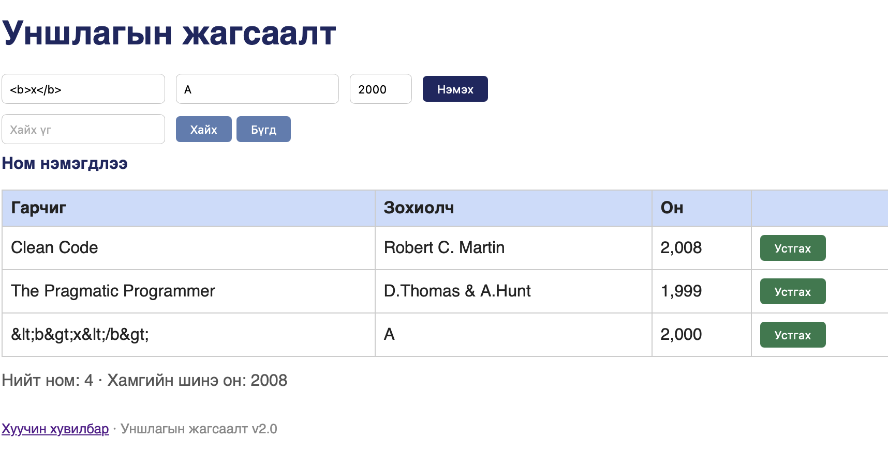

# BUG-05: Гарчигт оруулсан `<b>x</b>` нь сервер талд `&lt;b&gt;x&lt;/b&gt;` болж өөрчлөгдөж хадгалагдана

Орчин: Уншлагын жагсаалт v2.0, Safari, macOS, 2026-11-25 (session 2)

Урьдчилсан нөхцөл: node app.js шинээр асаасан

## Дахин гаргах алхам

1. http://localhost:3000 нээ.
2. Гарчиг = `<b>x</b>`, Зохиолч = А, Он = 2000 гэж ном нэм.
3. Хүснэгтэд гарчиг ямар харагдаж байгааг хар.
4. Терминалд `curl -s http://localhost:3000/api/books` ажиллуулж, JSON дахь title-ийг хар.

Хүлээгдэж байсан: гарчиг оруулсан хэвээрээ (`<b>x</b>`) хадгалагдаж, текст хэлбэрээр харагдана.

Бодит үр дүн: хүснэгтэд `&lt;b&gt;x&lt;/b&gt;` гэж харагдсан, API-ийн JSON дахь title мөн `&lt;b&gt;x&lt;/b&gt;` (өгөгдөл сервер талд өөрчлөгдөж хадгалагдсан). Тэмдэглэл: 13:57:28, 14:21:17.

Ноцтой байдал: Minor. Хэрэглэгчийн оруулсан өгөгдөл өөрчлөгдөж байна. Зарим тохиолдолд давхар кодчилол үүсэх эрсдэлтэй.

Хавсралт: , [evidence/s2-01-curl.txt](../evidence/s2-01-curl.txt)

Олдсон аялал: Back Alley
