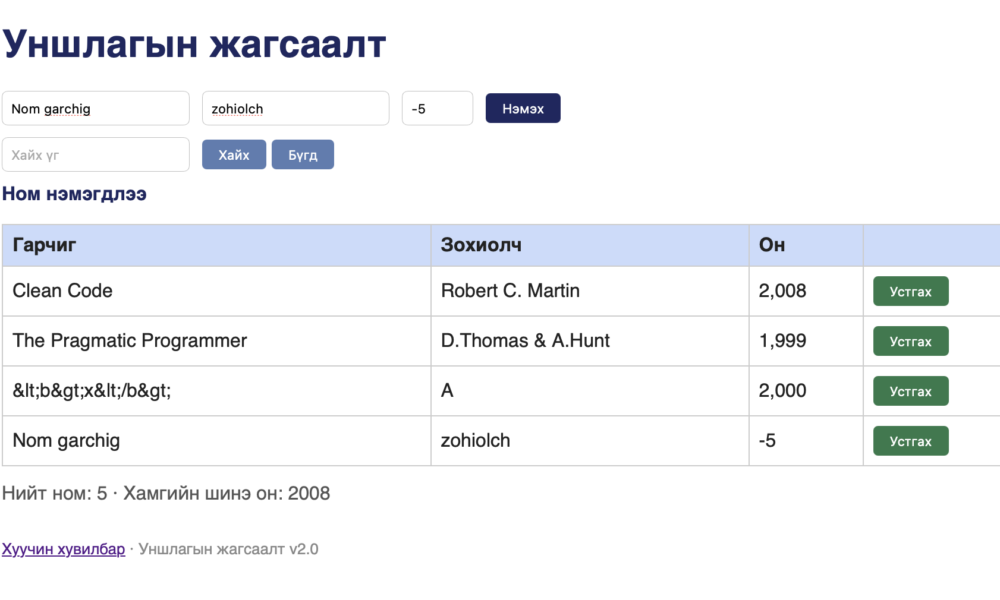

# BUG-06: Он талбар сөрөг утгыг (-5) хүлээн авна

Орчин: Уншлагын жагсаалт v2.0, Safari, macOS, 2026-11-25 (session 2)

Урьдчилсан нөхцөл: node app.js шинээр асаасан

## Дахин гаргах алхам

1. http://localhost:3000 нээ.
2. Гарчиг = Nom garchig, Зохиолч = zohiolch, Он = -5 гэж ном нэм.
3. Хүснэгтийн мөрийг хар.

Хүлээгдэж байсан: он буруу (сөрөг) тул шалгалтаар татгалзаж, алдааны мэдээлэл харуулна.

Бодит үр дүн: ном нэмэгдэж, хүснэгтэд Он = -5 гэж харагдсан. Тэмдэглэл: 14:03:14.

Ноцтой байдал: Minor. Утгын шалгалт байхгүй, буруу өгөгдөл хадгалагдана.

Хавсралт: 

Олдсон аялал: Back Alley
