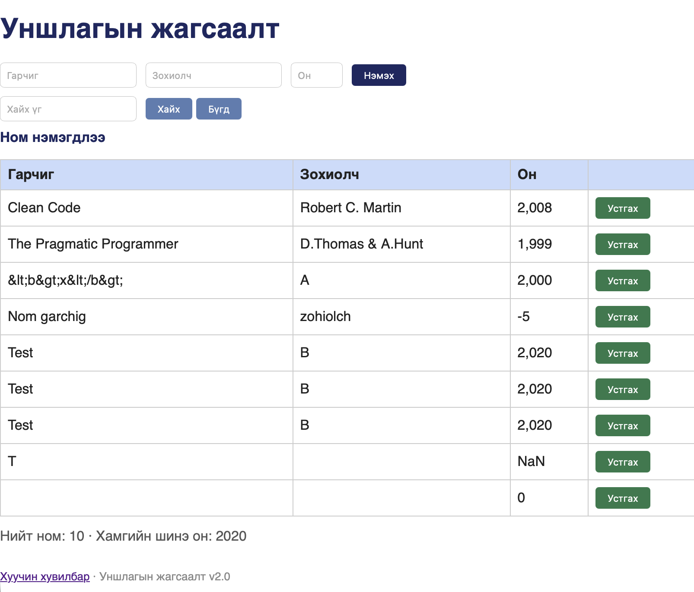

# BUG-07: API POST зөвхөн title-тай хүсэлтийг 201 Created гэж хүлээн авч, UI-д Зохиолч хоосон, Он=NaN харагдана

Орчин: Уншлагын жагсаалт v2.0, localhost:3000, curl, Safari, macOS, 2026-11-25 (session 2)

Урьдчилсан нөхцөл: node app.js ажиллаж байна

## Дахин гаргах алхам

1. Терминалд зөвхөн title-тай ном илгээ: `{"title":"T"}` (Content-Type: application/json) гэж `POST /api/books`.
2. Хариуг хар (evidence/s2-02-curl.txt).
3. Браузерт хуудсыг шинэчилж, шинэ мөрийг хар.

Хүлээгдэж байсан: спецификацаар гарчиг, зохиолч, он гурав заавал тул 400 алдаа буцаана.

Бодит үр дүн: 201 Created, id=10, ном үүссэн. UI-д Зохиолч хоосон, Он = NaN гэж харагдсан. Тэмдэглэл: 14:26:51, 14:28:04, 14:28:19.

Ноцтой байдал: Major. Шаардлагатай талбарын шалгалт API түвшинд байхгүй, өгөгдөл эвдэрнэ (BUG-03-ын API хувилбар).

Хавсралт: [evidence/s2-02-curl.txt](../evidence/s2-02-curl.txt), 

Олдсон аялал: Back Alley
