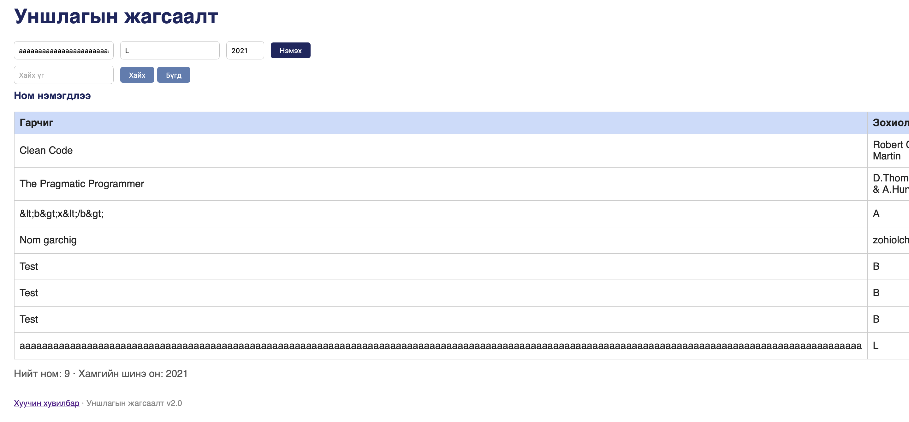

# BUG-08: Маш урт гарчиг хүснэгтийг хэт өргөн болгож, баганууд шахагдана

Орчин: Уншлагын жагсаалт v2.0, Safari, macOS, 2026-11-25 (session 2)

Урьдчилсан нөхцөл: node app.js шинээр асаасан

## Дахин гаргах алхам

1. http://localhost:3000 нээ.
2. Гарчигт ойролцоо 150 тэмдэгт `a`, Зохиолч = L, Он = 2021 оруулж ном нэм.
3. Хүснэгтийг хар.

Хүлээгдэж байсан: урт гарчиг мөр таслагдах эсвэл зөв шилжиж, хүснэгтийн зохион байгуулалт эвдрэхгүй.

Бодит үр дүн: ном нэмэгдсэн, хүснэгт хэт өргөн болж баганууд шахагдаж, хуудас хэвтээ гүйлгэгдэнэ. Тэмдэглэл: 14:18:39.

Ноцтой байдал: Minor (UI). Мэдээлэл алдагдахгүй, гэхдээ хэрэглэхэд төвөгтэй.

Хавсралт: 

Олдсон аялал: All-Nighter
